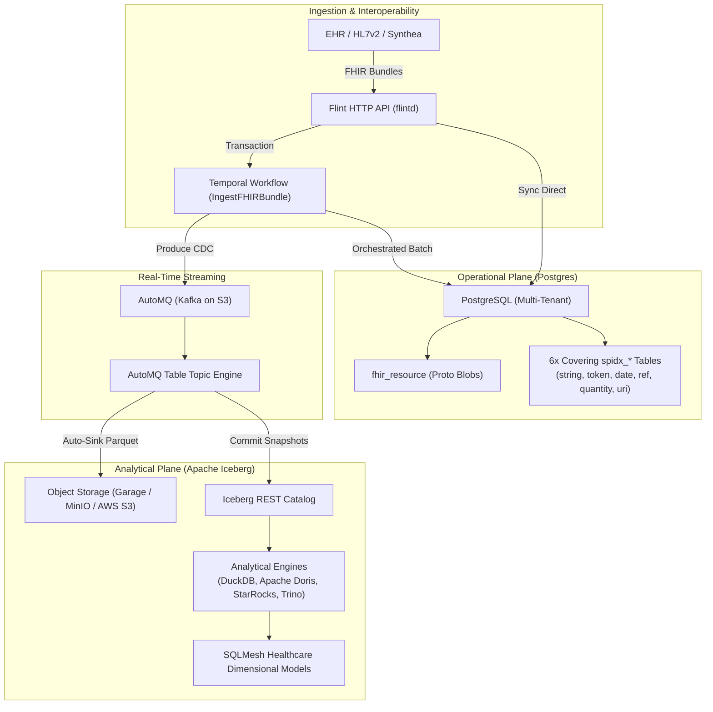
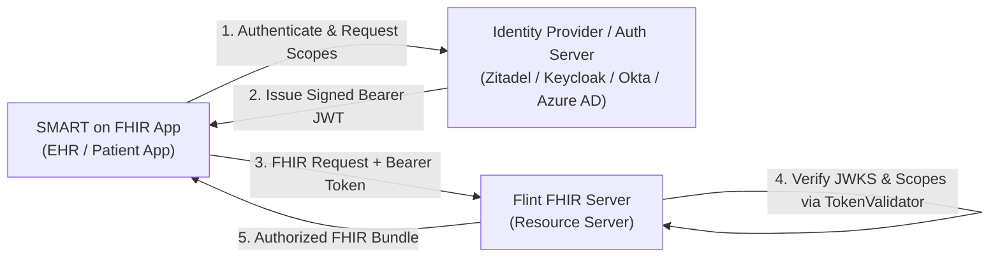

# Flint — High-Performance FHIR R4 Server on a Data Lakehouse

[](https://github.com/flint-fhir/flint/actions/workflows/ci.yml)
[](go.mod)
[](https://hl7.org/fhir/R4/)
[](LICENSE)
[](CODE_OF_CONDUCT.md)

**Flint** is an open-source, cloud-agnostic **FHIR R4 server** and **real-time clinical data lakehouse** engine. It combines high-throughput transactional EHR ingestion with instant analytical querying on **Apache Iceberg**, bridging the operational-analytical divide in healthcare data infrastructure.

All domain models, search index extractors, and storage structures are compiled directly from `google/fhir` Protocol Buffers using [proto2type](https://github.com/protocgen/proto2type).

---

## Why Flint?

Traditional FHIR servers (e.g. HAPI FHIR, Medplum) are optimized for transactional EHR exchange but create massive architectural bottlenecks when analytics, population health, and machine learning are needed:

| Dimension | Traditional FHIR Servers | Flint |
|:----------|:-------------------------|:------|
| **Data Format** | Heavy JSON / relational table sprawl | Compact Protocol Buffers (**16× wire reduction**, 124B vs ~2KB) |
| **Search Indexing** | Deep relational joins or Elasticsearch sync | **6 static covering index tables** per tenant (HAPI pattern), sub-10ms queries |
| **Analytics (OLAP)** | Nightly batch ETL / Flink JVM pipelines | **Zero-copy streaming CDC** to **Apache Iceberg** via AutoMQ Table Topics |
| **Schema Maintenance** | Manual migrations across hundreds of FHIR types | **100% generated** via `proto2type` from official HL7 SearchParameter JSON |
| **Multi-Tenancy** | Soft tenancy (`tenant_id` column filters) | **Schema-per-tenant physical isolation** for HIPAA compliance |
| **Throughput** | Bottlenecked by JVM garbage collection | **>1,400 resources/sec** transactional store, **>1,000 resources/sec** HTTP |

---

## Architecture



---

## Verified Benchmarks

Flint includes a dedicated benchmarking harness ([`cmd/loadtest`](cmd/loadtest/)) to measure ingestion throughput, database scaling, and latency percentiles on local and cloud environments:

* **Direct Postgres Store Ingestion**: **1,410+ resources/sec** (282+ bundles/sec) sustained with transactional ACID upserts and index extraction across Big 5 resources.
* **HTTP REST API Transaction Bundles**: **1,024+ resources/sec** (205+ bundles/sec) sustained with 100 concurrent workers and **100% 2xx success rate**.
* **AutoMQ Restart Recovery**: **Zero data loss** validated across broker container crash/restart with automatic offset resumption in Apache Iceberg.
* **Latency Profile**:
  * $p50 < 250\text{ms}$
  * $p90 < 360\text{ms}$
  * $p99 < 500\text{ms}$

---

## Supported FHIR Resources (Big 5)

Flint implements full search index extraction and transactional persistence for the Core Big 5 healthcare resources:

| Resource Type | Search Index Extraction | Covering Tables | Status |
|:--------------|:------------------------|:----------------|:-------|
| **`Patient`** | `name`, `identifier`, `birthdate`, `gender`, `active`, `address-postalcode` | `spidx_string`, `spidx_token`, `spidx_date` | ✅ Production Ready |
| **`Condition`** | `code`, `clinical-status`, `verification-status`, `patient`, `onset-date` | `spidx_token`, `spidx_reference`, `spidx_date` | ✅ Production Ready |
| **`Encounter`** | `status`, `class`, `type`, `subject`, `date` | `spidx_token`, `spidx_reference`, `spidx_date` | ✅ Production Ready |
| **`Observation`** | `status`, `category`, `code`, `subject`, `date`, `value-quantity`, `value-concept` | `spidx_token`, `spidx_reference`, `spidx_quantity`, `spidx_date` | ✅ Production Ready |
| **`Practitioner`** | `name`, `identifier`, `telecom`, `active` | `spidx_string`, `spidx_token` | ✅ Production Ready |

---

## Quickstart

### 1. Development Environment (Hermetic Nix Shell)

Flint provides a hermetic development environment with Nix and direnv:

```bash
# Clone the repository
git clone https://github.com/flint-fhir/flint.git
cd flint

# Allow direnv (or run nix develop)
direnv allow
```

### 2. Launch Local Dev Stack (k3d)

Spin up the local containerized stack (Postgres, Temporal, AutoMQ StatefulSet, Garage S3, Iceberg REST catalog):

```bash
task dev
```

Inspect service endpoints:
* **Flint Postgres**: `localhost:5432`
* **Temporal UI**: [http://localhost:8088](http://localhost:8088)
* **AutoMQ (Kafka)**: `localhost:9092`
* **Garage S3 Console**: [http://localhost:9001](http://localhost:9001)
* **Iceberg REST Catalog**: [http://localhost:8181](http://localhost:8181)

### 3. Build, Run & Seed Clinical Data

```bash
# Build flintd, worker, seed, and loadtest binaries
task build

# Run the Flint FHIR REST server (automatically applies SQL migrations on startup)
task run

# (In another terminal) Seed a longitudinal clinical cohort (15 FHIR R4 resources in tenant "demo")
task seed

# (Optional) Run the Temporal ingestion worker
task run-worker
```

### 4. Run Benchmarks & Tests

```bash
# Run Go unit, property, and integration tests
task test

# Run SQLMesh clinical dimensional lakehouse tests (DuckDB)
task test-analytics

# Run high-throughput HTTP load test
task bench-http

# Run direct Postgres store load test
task bench-store

# Run AutoMQ Table Topic restart recovery test
task test-recovery
```

### 5. Query Analytical Iceberg Table with DuckDB

Query the Iceberg lakehouse table populated by AutoMQ Table Topic:

```bash
uv run --with duckdb --with "pyiceberg[s3fs]" --with pyarrow cmd/e2e/query_duckdb.py
```

Output:
```
=== DuckDB SQL Query on Iceberg Table ===
       patient_id  partition  offset                                                               raw_json
e2e-recovery-post          3       0 {"gender":{"value":"male"},"id":{"value":"e2e-recovery-post"},"name":[...]}
 e2e-recovery-pre          0       0 {"gender":{"value":"male"},"id":{"value":"e2e-recovery-pre"},"name":[...]}
      e2e-wf-001          5       1 {"gender":{"value":"female"},"id":{"value":"e2e-wf-001"},"name":[{"family":"Wonderland"...}]}
      e2e-wf-002          3       0 {"gender":{"value":"male"},"id":{"value":"e2e-wf-002"},"name":[...]}
      e2e-wf-003          2       1 [tombstone]
```

---

## Copy-Pasteable API Cookbook (`curl`)

After running `task run` and `task seed`, you can explore the seeded `"demo"` tenant (`2 Practitioners`, `3 Patients`, `3 Encounters`, `2 Conditions`, `5 Observations`) directly from your terminal:

```bash
# 1. Assemble Alice Wonderland's complete longitudinal chart ($everything)
curl -s "http://localhost:8080/fhir/r4/demo/Patient/pat-alice-001/\$everything" | jq .

# 2. Search heart rate Observations > 70 bpm and include the referenced Patient
curl -s "http://localhost:8080/fhir/r4/demo/Observation?code=8867-4&value-quantity=gt70&_include=Observation:patient" | jq .

# 3. Chained search: find all Observations for patients with family name "Wonderland"
curl -s "http://localhost:8080/fhir/r4/demo/Observation?patient.family=Wonderland" | jq .

# 4. Date range search: find Encounters between 2026-01-01 and 2026-02-01
curl -s "http://localhost:8080/fhir/r4/demo/Encounter?date=ge2026-01-01&date=le2026-02-01" | jq .

# 5. Conditional Create (If-None-Exist): idempotently return existing Patient if MRN-1001 exists
curl -i -X POST "http://localhost:8080/fhir/r4/demo/Patient" \
  -H "Content-Type: application/fhir+json" \
  -H "If-None-Exist: identifier=http://hospital.example.org/mrn|MRN-1001" \
  -d '{"resourceType":"Patient","name":[{"family":"Wonderland","given":["Alice"]}]}'

# 6. Optimistic concurrency control (If-Match) + Version History (_history)
curl -i -X PUT "http://localhost:8080/fhir/r4/demo/Patient/pat-alice-001" \
  -H "Content-Type: application/fhir+json" \
  -H 'If-Match: W/"1"' \
  -d '{"resourceType":"Patient","id":"pat-alice-001","active":true,"gender":"female","birthDate":"1985-04-12","name":[{"family":"Wonderland","given":["Alice","Marie"]}]}'

curl -s "http://localhost:8080/fhir/r4/demo/Patient/pat-alice-001/_history" | jq .

# 7. Transaction Bundle with intra-bundle urn:uuid: reference resolution
curl -s -X POST "http://localhost:8080/fhir/r4/demo" \
  -H "Content-Type: application/fhir+json" \
  -d '{
    "resourceType": "Bundle",
    "type": "transaction",
    "entry": [
      {
        "fullUrl": "urn:uuid:11111111-2222-3333-4444-555555555555",
        "resource": {"resourceType": "Patient", "name": [{"family": " Curie", "given": ["Marie"]}], "gender": "female"},
        "request": {"method": "POST", "url": "Patient"}
      },
      {
        "fullUrl": "urn:uuid:66666666-7777-8888-9999-000000000000",
        "resource": {
          "resourceType": "Observation",
          "status": "final",
          "code": {"coding": [{"system": "http://loinc.org", "code": "8867-4"}]},
          "subject": {"reference": "urn:uuid:11111111-2222-3333-4444-555555555555"},
          "valueQuantity": {"value": 68, "unit": "/min", "system": "http://unitsofmeasure.org", "code": "/min"}
        },
        "request": {"method": "POST", "url": "Observation"}
      }
    ]
  }' | jq .

# 8. Validate a FHIR R4 resource without persisting ($validate)
curl -s -X POST "http://localhost:8080/fhir/r4/demo/Patient/\$validate" \
  -H "Content-Type: application/fhir+json" \
  -d '{"resourceType":"Patient","gender":"female","birthDate":"1990-05-15","name":[{"family":"Doe"}]}' | jq .

# 9. Query HIPAA / ONC Security AuditEvents
curl -s "http://localhost:8080/fhir/r4/demo/AuditEvent?patient=pat-alice-001&_count=5" | jq .
```

---

## API Reference

Flint implements standard FHIR R4 REST API interactions:

### Batch / Transaction Bundles
```http
POST /fhir/r4/{tenant}
Content-Type: application/fhir+json

{
  "resourceType": "Bundle",
  "type": "transaction",
  "entry": [
    {
      "resource": {
        "resourceType": "Patient",
        "id": "pat-123",
        "name": [{"family": "Smith", "given": ["Jane"]}],
        "gender": "female"
      },
      "request": { "method": "PUT", "url": "Patient/pat-123" }
    }
  ]
}
```

### Resource Interactions
* **Point Read**: `GET /fhir/r4/{tenant}/{resourceType}/{id}` (returns `ETag: W/"<version>"` and `Last-Modified`; `410 Gone` if deleted)
* **Version Read (`vread`)**: `GET /fhir/r4/{tenant}/{resourceType}/{id}/_history/{vid}`
* **Instance History (`_history`)**: `GET /fhir/r4/{tenant}/{resourceType}/{id}/_history?_count=100&_offset=0`
* **Create & Conditional Create (`If-None-Exist`)**: `POST /fhir/r4/{tenant}/{resourceType}` (`201 Created` + `Location` + `ETag`; when `If-None-Exist` header or Bundle `request.ifNoneExist` matches 1 existing resource, returns `200 OK` idempotently; returns `412 Precondition Failed` on multiple matches)
* **Update / Create-on-Update**: `PUT /fhir/r4/{tenant}/{resourceType}/{id}` (supports optimistic concurrency via `If-Match: W/"<version>"`, returning `412 Precondition Failed` on version conflict)
* **Soft Delete**: `DELETE /fhir/r4/{tenant}/{resourceType}/{id}` (`204 No Content` + tombstone version `ETag`)
* **Patient Compartment (`$everything`)**: `GET /fhir/r4/{tenant}/Patient/{id}/$everything?_type=Encounter,Condition,Observation&_since=2025-01-01T00:00:00Z&_count=100&_offset=0` (returns a `searchset` Bundle containing the target `Patient` plus all compartment-linked resources via `spidx_reference` and referenced `Practitioner` records)
* **Validate**: `POST /fhir/r4/{tenant}/{resourceType}/$validate` and `POST /fhir/r4/{tenant}/$validate`
* **Search**: `GET /fhir/r4/{tenant}/{resourceType}?{searchParams}&_count=20&_offset=0`
* **Security Audit Log (`AuditEvent`)**: `GET /fhir/r4/{tenant}/AuditEvent?entity=Patient/123&outcome=0&agent=Practitioner/dr-smith` and `GET /fhir/r4/{tenant}/AuditEvent/{id}`
* **CapabilityStatement**: `GET /fhir/r4/{tenant}/metadata`
* **SMART Discovery**: `GET /fhir/r4/{tenant}/.well-known/smart-configuration`

### FHIR Conformance & Validation Engine (`pkg/validation`)
Flint validates incoming FHIR resources prior to persistence and exposes standard validation operations:
* **StructureDefinition Enforcement**: Validates elements against official HL7 FHIR R4 StructureDefinitions. Undeclared elements are rejected in strict mode (`structure`).
* **Cardinality Verification**: Mandatory 1..1 elements (e.g., `Observation.status`, `Observation.code`, `Condition.subject`, `Encounter.status`, `Encounter.class`) must be present and non-empty (`required`).
* **Required ValueSets**: Bound code elements (e.g., `AdministrativeGender`, `ObservationStatus`, `ConditionClinicalStatus`, `EncounterStatus`) are strictly matched against canonical ValueSets (`code-invalid`).
* **Primitive Format Constraints**: Primitive fields (`id`, `date`, `dateTime`, `instant`) are validated against FHIR regex patterns (`value`).
* **OperationOutcome Diagnostics**: Detailed, structured responses with issue severities, diagnostic reasons, and FHIRPath element expressions (e.g. `Observation.status`).
* **Standard `$validate` Operation**: Supports resource-level (`POST /fhir/r4/{tenant}/{resourceType}/$validate`) and system-level (`POST /fhir/r4/{tenant}/$validate`) operations, accepting raw JSON or FHIR `Parameters` payloads without persisting to storage.
* **Bundle Validation**: Transaction bundles validate all resource entries before commit, guaranteeing transaction atomicity.
* **Property-Based Testing**: Validated using generative property testing with [Hegel](https://hegel.dev) to ensure parser invariance and fuzzing safety.

### Advanced FHIR Search Engine
Flint implements high-performance relational search against the covering `spidx_*` index tables:
* **Date Range Queries**: Supports FHIR prefix comparators (`eq`, `ne`, `lt`, `le`, `gt`, `ge`, `sa`, `eb`, `ap`) and multi-value intersections over `spidx_date` timestamps:
  ```http
  GET /fhir/r4/tenant-a/Patient?birthdate=ge1980-01-01&birthdate=le1995-12-31
  ```
* **Quantity Queries**: Supports comparator prefixes (`gt`, `lt`, `ge`, `le`, `eq`), systems, units, and multi-value ranges over `spidx_quantity`:
  ```http
  GET /fhir/r4/tenant-a/Observation?value-quantity=gt70|http://unitsofmeasure.org|kg
  ```
* **Include & Reverse Include**: Resolves target/source references across tables with bundle `"search": {"mode": "match" | "include"}` annotations:
  ```http
  GET /fhir/r4/tenant-a/Observation?code=29463-7&_include=Observation:patient
  GET /fhir/r4/tenant-a/Patient?family=smith&_revinclude=Observation:patient
  ```
* **Chained Searches**: Joins reference indexes with target parameter tables across string, token, date, and quantity parameters:
  ```http
  GET /fhir/r4/tenant-a/Observation?patient.name=smith
  GET /fhir/r4/tenant-a/Observation?patient.identifier=http://hospital.example.org/mrn|MRN-1001
  ```

---

## SMART on FHIR v2 & Identity Architecture

Flint functions strictly as a high-performance **FHIR Resource Server (RS)**, delegating user authentication, password hashing, and login UI to OpenID Connect (OIDC) Identity Providers.



### Decoupled `TokenValidator` Interface (`pkg/auth`)
Flint protects endpoints through a pluggable interface:
* **`OIDCValidator`**: Standard OIDC and JWKS caching with RS256/ES256 verification and refresh rate-limiting (compatible with Okta, Azure AD, Keycloak, Auth0).
* **`ZitadelValidator`**: Specialized decorator mapping Zitadel organization domains to Flint tenant schemas, user metadata to patient IDs, and project roles to clinical SMART scopes.
* **`MockTokenValidator`**: In-memory ECDSA P-256 keypair signer and validator enabling sub-millisecond, zero-dependency unit tests.

### Security Guarantees
1. **SMART v1 & v2 Scopes**: Granular action enforcement (`c`, `r`, `u`, `d`, `s`) across patient, user, and system tiers, including `_include`, `_revinclude`, and `Patient/$everything`.
2. **Tenant Boundary Enforcement**: Rejects cross-tenant token access with HTTP 403.
3. **Patient Compartment Isolation**: When a token carries `patient/*` scopes or a `patient_id` launch claim:
   * Missing `patient_id` claims on `patient/*` tokens fail closed with `403 Forbidden`.
   * Reading, searching, or mutating records of another patient returns `403 Forbidden`.
   * Patient-scoped tokens are blocked from mutating shared non-compartment resources such as `Practitioner`.
4. **HIPAA / ONC Security Audit Logging (`AuditEvent`)**: Every clinical REST interaction (`read`, `vread`, `update`, `delete`, `history-instance`, `create`, `search-type`, `batch`, `everything`, `validate`) and security rejection (`401 Unauthorized` / `403 Forbidden`) is recorded in `fhir_audit_event` with actor identity, patient compartment attribution, client IP, and target entity reference, and is queryable via `GET /fhir/r4/{tenant}/AuditEvent`.

### Environment Configuration
```bash
# Enable SMART on FHIR with Zitadel
FLINT_OIDC_ISSUER="https://auth.azra.dev"
FLINT_OIDC_AUDIENCE="flint-api"
FLINT_AUTH_PROVIDER="zitadel"
FLINT_ZITADEL_TENANT_FROM_DOMAIN="true"
FLINT_SMART_AUTH_URL="https://auth.azra.dev/oauth/v2/authorize"
FLINT_SMART_TOKEN_URL="https://auth.azra.dev/oauth/v2/token"
```

---

## Property-Based Testing (via Hegel)

Flint leverages [Hegel](https://hegel.dev) (`hegel.dev/go/hegel`) for type-driven, generative property-based testing. Instead of checking only human-authored table cases, Hegel draws inputs across formal grammars and shrinks failures to minimal counterexamples:

* **Scope Grammar Invariance**: Validates that all strings matching the formal SMART v1/v2 grammar parse deterministically.
* **Query Filter Invariance**: Asserts that fine-grained query filters (`?category=vital-signs`) never alter base resource permissions.
* **Search Parameter Invariance**: Verifies parser prefix and grammar preservation across generated ISO date formats, decimal quantities, units, and `_include`/`_revinclude` strings.
* **Conditional Create (`If-None-Exist`) Invariance**: Verifies search criteria query string parsing and deterministic round-trip matching.
* **AuditEvent Classification & Serialization Invariance**: Verifies HTTP status-to-outcome partitioning (`0`, `4`, `8`) and round-trip FHIR R4 `AuditEvent` serialization across generated inputs.
* **No-Panic Invariance**: Fuzzes parsers with arbitrary inputs and unicode sequences to guarantee zero crashes or hangs.

---

## Clinical Dimensional Lakehouse (`analytics/` — SQLMesh on DuckDB / Iceberg)

Flint ships with an out-of-the-box **SQLMesh** analytical pipeline (`analytics/`) that transforms raw AutoMQ Table Topic Iceberg CDC streams (`fhir_raw.patient`, `fhir_raw.encounter`, `fhir_raw.condition`, `fhir_raw.observation`) into a Kimball healthcare dimensional model:

* **Staging Layer (`flint_stg.stg_*`)**:
  * Deduplicates multi-tenant CDC events by `(tenant_id, res_id)` (normalizing `{tenant_id}/{res_id}` Kafka keys) using the latest `_kafka_offset`.
  * Filters out hard/soft delete tombstones (`op = 'D'` or `[tombstone]`).
  * Supports dual extraction across `google/fhir` wrapped JSON (`{"value": "..."}`) and standard flat HL7 FHIR R4 JSON.
* **Dimensional & Fact Layer (`flint_marts.dim_*`, `flint_marts.fct_*`)**:
  * `dim_patient`: Demographics, full name, birth date, gender, postal code, and active flag.
  * `fct_encounter`: Encounter class (`AMB`, `IMP`), status, period timestamps, and calculated length-of-stay (`los_hours`).
  * `fct_condition`: SNOMED/ICD-10 condition codes, clinical/verification status, and onset date.
  * `fct_observation`: LOINC observation codes, status, numeric `value_quantity`, `value_unit`, and effective timestamps.
* **Longitudinal Patient 360 Mart (`flint_marts.mart_patient_360`)**:
  * Single-row-per-patient population health summary aggregating total encounters, latest encounter timestamp, total/active condition counts, and observation counts/timestamps.

Run the hermetic SQLMesh unit test suite locally via `uv` and DuckDB:
```bash
task test-analytics
```

---

## Project Structure

```
flint/
├── analytics/            # SQLMesh clinical dimensional lakehouse models & DuckDB unit tests
├── automq/               # Franz-go Kafka producer with tenant-scoped CDC keys & headers
├── bin/                  # Compiled binaries (flintd, worker, seed, loadtest)
├── cmd/
│   ├── flintd/           # FHIR REST HTTP server entrypoint
│   ├── worker/           # Temporal ingestion worker entrypoint
│   ├── seed/             # Deterministic clinical cohort seeder (task seed)
│   ├── loadtest/         # High-throughput load testing harness
│   └── e2e/              # End-to-end integration & restart recovery tests
├── deploy/
│   ├── k3d/              # Local k3d cluster configuration
│   └── k8s/              # Kubernetes manifests (Postgres, Temporal, AutoMQ StatefulSet, Iceberg)
├── fhir/r4/              # Machine-readable HL7 FHIR R4 SearchParameter definitions
├── gen/go/
│   ├── flint/auth/v1/    # Protobuf-generated security context and discovery types
│   └── store/postgres/   # proto2type generated search index extractors
├── ingest/
│   ├── activity/         # Temporal activities (WritePostgresBatch, AutoMQ CDC)
│   └── workflow/         # Temporal IngestFHIRBundle workflow
├── pkg/
│   ├── audit/            # HIPAA/ONC FHIR R4 AuditEvent classification, serialization & recorders
│   ├── auth/             # TokenValidator, OIDC/Zitadel, and Hegel property tests
│   ├── fhirutil/         # Bidirectional flat FHIR R4 JSON <-> google/fhir protojson codec & helpers
│   └── validation/       # FHIR StructureDefinition, ValueSet, and cardinality validator
├── proto/
│   ├── flint/auth/v1/    # Canonical Protobuf schemas for auth & security context
│   └── google/fhir/      # Vendored google/fhir R4 protocol buffers
├── server/               # stdlib HTTP router, Bundle engine, SMART discovery, auth/audit middleware
├── store/postgres/       # Operational store, Atlas SQL migrations, spidx_* tables
├── flake.nix             # Hermetic Nix development environment
├── lefthook.yml          # Git pre-commit & pre-push hooks
└── Taskfile.yaml         # Project workflow automation tasks
```

---

## Community & Contributing

We welcome contributions! Please see our:
* [Code of Conduct](CODE_OF_CONDUCT.md)
* [Contributing Guide](CONTRIBUTING.md)
* [Security Policy](SECURITY.md)

---

## License

Flint is licensed under the [Apache License 2.0](LICENSE).
