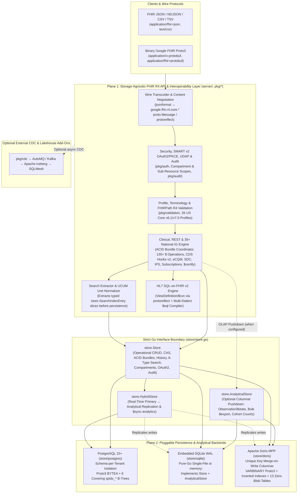

# Flint Architecture: Decoupled FHIR R4 API Layer & Pluggable Storage Plane

Flint is designed around a strict two-plane separation:

1. **The FHIR R4 API & Interoperability Layer (`server/`, `pkg/*`)** — A storage-agnostic clinical protocol engine that owns HTTP/wire negotiation, SMART on FHIR v2 security, validation, FHIRPath R4 evaluation, UCUM canonicalization, 35+ National HL7 Implementation Guides (130+ operations), and HL7 SQL-on-FHIR v2 compilation.
2. **The Pluggable Persistence & Analytical Storage Layer (`store/`)** — A narrow, SQL-free Go interface boundary ([`store.Store`](../store/store.go) and [`store.AnalyticalStore`](../store/store.go)) implemented by **PostgreSQL** (`store/postgres`), **Embedded SQLite WAL** (`store/sqlite`), **Apache Doris MPP** (`store/doris`), and real-time dual-plane **[`store.HybridStore`](../store/hybrid.go)** topologies.

Because zero database drivers or SQL queries leak above `store/store.go`, the exact same `flintd` binary and [`server.Server`](../server/server.go) instance pass **137/137 automated conformance checks (`$certify`)** regardless of whether the underlying store is a single `:memory:` SQLite database on a laptop, a multi-tenant PostgreSQL cluster, an Apache Doris MPP analytical cluster, or a Hybrid OLTP + OLAP deployment.

---

## 1. High-Level Two-Plane Architecture

---

## 2. Why Decouple the FHIR API Layer from Storage?

Conventional FHIR servers store resources as `JSONB` documents and push FHIR path expressions directly into database-specific JSON operators (`->>`, `@>`, GIN path ops). That design couples every REST interaction, search modifier, and clinical operation to a single RDBMS dialect while paying JSON text-parsing overhead on both writes and reads.

Flint inverts this model through three architectural invariants:

1. **Protobuf (`google/fhir`) Is the Canonical In-Memory & At-Rest Representation**:
   - Incoming `application/fhir+json` payloads are unmarshaled once at the HTTP edge into strongly typed `google.fhir.r4.core.*` `proto.Message` structs (and `application/x-protobuf` / `application/fhir+protobuf` requests skip JSON parsing altogether).
   - Storage backends receive pre-serialized, deterministic Proto3 wire bytes (`[]byte`) plus pre-extracted metadata—never raw JSON strings.
2. **Search Extraction & UCUM Normalization Happen in the API Layer**:
   - Before invoking `store.WriteResourceWithMeta` or `store.ExecuteTransactionBundle`, the API layer inspects the `proto.Message` via generated extractors and `protoreflect`, canonicalizes UCUM clinical units (`pkg/ucum`, e.g., `150 [lb_av]` → `68.0389 kg`, `98.6 [degF]` → `310.15 K`), and emits normalized `SearchIndexEntry` values across FHIR's 6 index families (`string`, `token`, `reference`, `date`, `number`, `quantity`).
   - Storage backends only index and query clean typed primitives—they do not need embedded FHIR or UCUM domain logic.
3. **Clinical Semantics & Multi-IG Workflows Compose Over `store.Store`**:
   - All 130+ `$` operations, 35+ National HL7 IGs, SMART on FHIR v2 scope filters, FHIR Subscriptions (`rest-hook`), CDS Hooks v2.0 services, CQL/FHIRPath eCQMs (`$evaluate-measure`, `$care-gaps`), `ViewDefinition/$run`, and `TestScript/$evaluate` sit in `server/` above `store.Store`. Adding a new storage backend immediately inherits the entire FHIR R4 & National IG surface for free.

---

## 3. Plane 1: Responsibilities of the FHIR R4 API Layer (`server/`, `pkg/*`)

| Subsystem | Package(s) | Responsibility |
| :--- | :--- | :--- |
| **Wire & Content Negotiation** | [`server/`](../server/server.go), [`pkg/fhirutil`](../pkg/fhirutil) | Negotiates `application/fhir+json`, `application/fhir+ndjson`, `text/csv`, `text/tab-separated-values`, `application/x-protobuf`, and `application/fhir+protobuf`; handles `_summary`, `_elements` (`SUBSETTED`), `Prefer`, and RFC 6902 / RFC 7396 / FHIRPath `PATCH`. |
| **Identity, SMART v2 & UDAP** | [`pkg/auth`](../pkg/auth), `server/smart_*.go` | Built-in SMART App Launch v2.0.0 OAuth2 server (`S256` PKCE, Backend Services `private_key_jwt` RFC 7523, token introspection/revocation), UDAP dynamic client registration, external OIDC/Zitadel JWT validation, patient compartment enforcement, and v2 sub-resource scope filtering (`?category=vital-signs`). |
| **Validation & FHIRPath R4** | [`pkg/validation`](../pkg/validation) | Validates cardinality, choice-type invariants, terminology bindings, regex patterns, reference targets, and FHIRPath constraints across all 146 FHIR R4 resources and 26 built-in US Core v6.1.0 & v7.0.0 profiles (`$validate` + write-time enforcement). |
| **Search & UCUM Engine** | `server/search_*.go`, [`pkg/ucum`](../pkg/ucum) | Parses FHIR R4 search queries (chained parameters, recursive `_has`, composites, `:in`/`:not-in`/`:below`/`:above` terminology modifiers, `_filter` ASTs, `_include`/`_revinclude:iterate`) into backend-neutral [`store.SearchParams`](../store/store.go) structs and normalizes UCUM quantities. |
| **Clinical & National IGs** | `server/*_ops.go` | Implements 35+ HL7 IGs & 130+ operations (`$everything`, `$summary` IPS, `$docref`, `$populate`/`$extract` SDC, `$evaluate-measure`/`$care-gaps`, `PlanDefinition/$apply`, Da Vinci suite, CARIN BB, FAST, Gravity SDOH, mCODE, PACIO, Public Health, Vulcan, Subscriptions, CDS Hooks v2.0). |
| **SQL-on-FHIR v2** | `server/sqlonfhir.go` | Evaluates `ViewDefinition/$run` and `$export` in-memory over `protoreflect` against *any* `store.Store`, and compiles `ViewDefinition/$sql` into native zero-JSON SQL for `postgres`, `sqlite`, and `doris`. |
| **Audit & Conformance** | [`pkg/audit`](../pkg/audit), [`pkg/certify`](../pkg/certify/certify.go) | Automatically records ASTM E2147 / ONC `(d)(2)` `AuditEvent` trails and runs the 137-check `$certify` conformance harness and `TestScript/$evaluate` engine. |

---

## 4. The Interface Boundary (`store/store.go`)

### 4.1 `store.Store` (Operational Contract)

[`store.Store`](../store/store.go) is the single operational persistence interface injected into `server.New(st, logger)`:

- **Lifecycle & Concurrency-Safe CRUD**: `WriteResourceWithMeta`, `GetResource`, `DeleteResource`, `ConditionalCreateResource`, `ConditionalUpdateResource`, `ConditionalDeleteResource`, `ConditionalDeleteResources` — enforcing optimistic concurrency (`If-Match: W/"<version>"` → `store.ErrConflict` → HTTP `412 Precondition Failed`).
- **Atomic ACID Bundles**: `ExecuteTransactionBundle` executes ordered `DELETE → POST → PUT/PATCH` mutations inside an isolated backend transaction with `urn:uuid:` and conditional reference resolution, rolling back atomically on any conflict or error.
- **Versioning & History**: `GetResourceVersion`, `ListResourceHistory`, `ListTypeHistory`, `ListSystemHistory`, and administrative `$expunge` (`Expunge`).
- **6-Type Covering Search**: `SearchResources` evaluates [`store.SearchParams`](../store/store.go) (`string`, `token`, `reference`, `date`, `number`, `quantity`, `_has`, chains, composites, `_filter`, `_include`, `_revinclude`, sorting, and offset/count pagination) and returns raw Proto3 blobs + version metadata.
- **Compartment & Graph Traversal**: `GetPatientEverything`, `GetEncounterEverything`, and `TraverseGraph` (`$graph` / `Composition/$document`).
- **Streaming Bulk Export, Audit & OAuth2 State**: `ExportResources` (cursor/streamed NDJSON emission), `CreateExportJob`/`GetExportJob`/`UpdateExportJob`, `RecordAuditEvent`/`QueryAuditEvents`, and SMART OAuth2 auth-code / refresh-token persistence.

### 4.2 `store.AnalyticalStore` (Optional Columnar OLAP Pushdown Contract)

[`store.AnalyticalStore`](../store/store.go) is an optional capability interface wired via `srv.SetAnalyticalStore(as)` (or auto-detected when `st` itself implements `AnalyticalStore`):

- `EvaluateObservationStats(ctx, ObservationStatsParams)` — Pushes `Observation/$stats` (`count`, `average`, `min`, `max`, `sum`, `median`, `stdDev`, `variance`) down to columnar vectorized execution.
- `StreamAnalyticalExport(ctx, ExportParams, emit)` — Streams high-volume Bulk Data `$export` cohorts off the analytical replica without contending with OLTP locks.
- `EvaluateCohortCounts(ctx, tenantID, resourceTypes)` — Accelerates population and `Measure` cohort cardinality queries.

When no `AnalyticalStore` is configured (`--analytics-store=none`), `server.Server` transparently executes these operations against `store.Store` with identical FHIR output.

### 4.3 `store.HybridStore` (Real-Time Dual-Plane Replication)

[`store.HybridStore`](../store/hybrid.go) composes any operational `store.Store` primary (such as PostgreSQL) with a dedicated `store.AnalyticalStore` replica (such as Apache Doris or SQLite):

- Every committed operational mutation (`WriteResourceWithMeta`, `DeleteResource`, `Conditional*`, `ExecuteTransactionBundle`) is synchronously or group-commit replicated to the analytical store.
- `POST /fhir/r4/{tenant}/$sync-analytics` backfills existing primary resources into the analytical replica idempotently and reports `X-Flint-Analytics-Backend` headers on OLAP-accelerated responses.

---

## 5. Plane 2: Pluggable Storage Topologies & When to Choose Each

All topologies expose **100% identical FHIR R4 REST, Search, SMART v2, IG, and `$certify` (`137/137`) behavior**—only CLI flags or environment variables change:

| Topology | CLI Flags / Env Vars | Storage Layout | Ideal Use Case |
| :--- | :--- | :--- | :--- |
| **1. PostgreSQL OLTP** *(Default)* | `--store=postgres` `FLINT_POSTGRES_DSN=...` `--tenant-isolation=schema\|shared` | Physical `tenant_<slug>` schemas (or shared RLS), Proto3 `BYTEA` blobs, 6 HAPI-style covering `spidx_*` B-tree tables. | Production multi-tenant EHRs, digital health platforms, strict HIPAA schema isolation, sub-10ms ACID transactions. |
| **2. Embedded SQLite WAL** | `--store=sqlite` `--sqlite-dsn=flint.db` *(or `:memory:`)* | Pure-Go (`CGO_ENABLED=0`) SQLite in WAL mode implementing both `store.Store` & `store.AnalyticalStore`. | Zero-dependency single-binary deployments, local developer sandboxes, CI/CD pipelines, desktop/edge clinical appliances. |
| **3. Apache Doris MPP** | `--store=doris` `FLINT_DORIS_DSN=...` | Unique Key Merge-on-Write (MoW) columnar tables (`VARBINARY` Proto3 + `ARRAY<VARCHAR>` inverted indexes + 13 zero-blob US Core tables). | Cloud-native analytical FHIR repositories, population health data warehouses, unified MPP OLAP + point lookups. |
| **4. Hybrid Postgres + Doris** | `--store=postgres` `--analytics-store=doris` | PostgreSQL handles OLTP writes/reads; `HybridStore` replicates to Doris MPP for `$stats`, `$export`, and cohort OLAP. | High-concurrency clinical systems needing both strict PostgreSQL OLTP ACID guarantees and petabyte-scale MPP analytics. |
| **5. Hybrid Postgres + SQLite** | `--store=postgres` `--analytics-store=sqlite` | PostgreSQL primary paired with a local embedded SQLite WAL analytical replica. | Lightweight read/analytics offloading and dual-plane replication testing without external MPP infrastructure. |
| **6. Ephemeral In-Process** | `server.New(nil, logger)` *(Go SDK)* | Stateless in-memory server without external persistence. | High-speed `$validate`, terminology, FHIRPath, `ViewDefinition/$sql` compilation, and unit testing. |

### Optional External CDC & Lakehouse Plane (`pkg/cdc`, `analytics/`, `cmd/worker`)

Orthogonal to `store.Store`, `flintd` can publish committed Protobuf mutations via [`pkg/cdc`](../pkg/cdc) (`FLINT_AUTOMQ_BROKERS`) to AutoMQ / Kafka and Apache Iceberg table topics, feeding downstream **SQLMesh** dimensional marts (`analytics/models/mart_patient_360.sql`, CMS165/CMS122 eCQM marts) and optional **Temporal** ingestion workflows (`cmd/worker`).

---

## 6. End-to-End Request Lifecycle Walkthrough

### Write Path (`POST /fhir/r4/acme/Observation`)
1. **Wire Decode (`server/`)**: If `Content-Type` is `application/x-protobuf`, `proto.Unmarshal` decodes directly into `*obspb.Observation` (zero JSON allocation). If `application/fhir+json`, `jsonformat.Unmarshaller` parses into `*obspb.Observation`.
2. **Auth & Scope Check (`pkg/auth`)**: Validates SMART v2 JWT, tenant claim (`acme`), patient compartment, and granular write scope (`user/Observation.cu` or `system/*.cruds`).
3. **Profile & FHIRPath Validation (`pkg/validation`)**: Enforces FHIR R4 structural invariants and declared `meta.profile` constraints (e.g., US Core Vital Signs).
4. **Search Index & UCUM Extraction (`server/`)**: Assigns `id`, `meta.versionId`, and `meta.lastUpdated`, serializes deterministic Proto3 bytes, normalizes `valueQuantity` via `pkg/ucum`, and builds `[]store.SearchIndexEntry`.
5. **Pluggable Persistence (`store.Store`)**: Calls `st.WriteResourceWithMeta(ctx, input)`. PostgreSQL writes to `tenant_acme.fhir_resources` + `spidx_*`; SQLite writes to WAL tables; Doris upserts into Unique Key MoW tables; `HybridStore` replicates to the `AnalyticalStore`.
6. **Side Effects (`server/`)**: Records an ASTM E2147 `AuditEvent`, evaluates active `Subscription` criteria for `rest-hook` delivery, optionally emits CDC to AutoMQ, and serializes the HTTP `201 Created` response in the caller's `Accept` wire format (`JSON` or `Proto3`).

### Analytical Pushdown Path (`GET /fhir/r4/acme/Observation/$stats` or `ViewDefinition/$sql`)
- For `Observation/$stats` and Bulk `$export`, `server.Server` checks `s.analyticalStore`: when present (`doris` or `sqlite`), execution is pushed directly into columnar/SQL aggregation via `AnalyticalStore` and tagged with `X-Flint-Analytics-Backend`.
- For `ViewDefinition/$sql?dialect=postgres|sqlite|doris`, Flint's SQL-on-FHIR v2 compiler translates FHIRPath column projections, nested `forEach` unnesting, and `where` predicates into native zero-JSON SQL tailored to the target storage engine's physical schema (`spidx_*` subqueries on Postgres/SQLite or typed columnar projections + `EXPLODE` on Doris).
